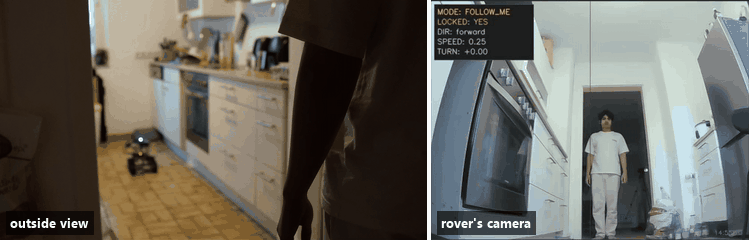
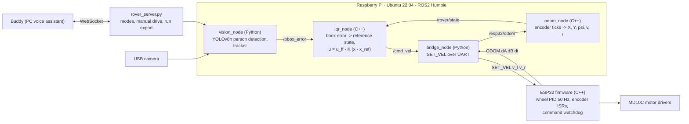
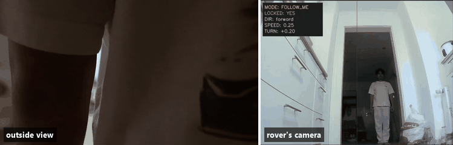
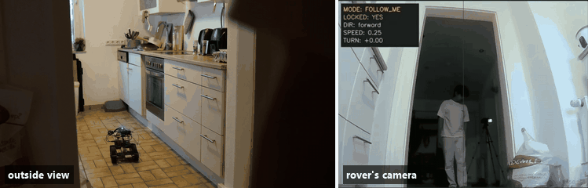
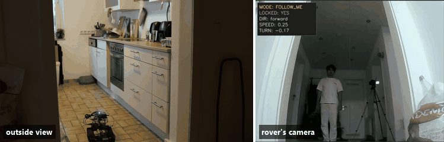

# Rover: vision follow-me with LQR control

A differential-drive rover that follows a person it sees through its camera. Perception runs in Python on a
Raspberry Pi, the controller is an **LQR in C++** (ROS2), and an **ESP32** closes the wheel-velocity loop with a PID at 50 Hz.
Tested end to end on the real rover.



One continuous run, outside view on the left and the rover's camera with its live control overlay on the right; all four
phases are [below](#one-run-four-phases).

## How it works



| Part | Path | Notes |
|---|---|---|
| LQR controller | `src/rover_control/` (C++) | 5-state model `[X, Y, psi, v, r]`, 2 inputs (wheel speeds); gain K designed offline in MATLAB |
| Odometry | `src/rover_control/src/odom_node.cpp` (C++) | integrates ESP32 encoder deltas into the state the LQR needs |
| Wheel firmware | `firmware/esp32/esp32_controller.cpp` (C++) | velocity PID with static-friction feedforward and an integral limit, quadrature encoders on interrupts |
| Perception | `src/rover_bridge/rover_bridge/vision/` (Python) | YOLOv8n detection, tracker with confidence and lost-frame counting; face recognition to lock onto the owner exists but is bypassed in the current build |
| ROS2 <-> ESP32 | `src/rover_bridge/rover_bridge/bridge_node.py` | `/cmd_vel` to `SET_VEL` over UART, odometry and warnings back |
| Assistant link | `src/rover_bridge/rover_bridge/rover_server.py` | WebSocket server used by [Buddy](https://github.com/mahesaputranata/buddy) to switch modes and drive |
| Run analysis | `tools/run_analysis/` | see below |

## One run, four phases

I walk backwards out of the kitchen into the hallway; the rover follows the whole way. The overlay shows the live
`SPEED` and `TURN` commands.

| | |
|---|---|
| **1. Lock on, drive straight.** Target centred in the doorway. |  |
| **2. Target moves off-centre.** The rover steers back toward the person. |  |
| **3. Reaching the doorway.** The person moves back into the hall; the heading is corrected the other way. |  |
| **4. Into the hallway.** Following through the door, still correcting. |  |

## Stopping safely

Each layer stops the motors on its own when the layer above goes quiet, so no single failure leaves the rover driving:

- **Target lost** (vision): the tracker marks the target invalid after a set number of lost frames; the LQR then sets the
  reference speed to zero and holds the current heading.
- **Stale inputs** (`lqr_node`): if odometry or the bbox stream is older than 0.5 s for three consecutive checks, it publishes a
  zero `Twist`.
- **Pi goes silent** (ESP32): no command for 2 s stops both motors (`WARN WATCHDOG_STOP`).
- **Shutdown** (`bridge_node`): sends `STOP` to the ESP32 before closing the serial port.

## Measuring a run

Every follow-me session is recorded as a ROS2 bag (`run_recorder.py`). `tools/run_analysis/summarize_run.py` turns a run into
`summary.json` and plots, and a small rulebook flags known failure modes, for example:

| Flag | Meaning |
|---|---|
| `TURN_SIGN` | the turn command points away from the person |
| `ODOM_SIGN` | measured yaw rate disagrees with the commanded turn |
| `LOST_GAP`, `VALID_LOW` | the target was lost for too long / too often |
| `TURN_DEADBAND`, `PULSE_WEAK` | turn commands too small to overcome wheel friction |
| `MOTOR_STALL` | wheels at max PWM with ~0 measured speed (power or battery) |

```bash
python tools/run_analysis/fetch_and_summarize.py --host <rover-host> --run last   # PC side, no ROS needed
```

## Build and run (on the Pi)

```bash
colcon build && source install/setup.bash          # from the repo root: it is the ROS2 workspace
ros2 run rover_bridge bridge_node                    # terminal 1: UART bridge to the ESP32
ros2 launch rover_control control.launch.py          # terminal 2: odom_node + lqr_node
python3 src/rover_bridge/rover_bridge/rover_server.py   # terminal 3: WebSocket server, starts vision on FOLLOW_ME
```

The ESP32 firmware is a single Arduino sketch (`firmware/esp32/`). `fake_vision.py` publishes a scripted `/bbox_error` to test the
controller without a camera. Model weights are not in the repo: `yolov8n.pt` downloads on first use, the door model via
`vision/tools/download_door_model.py`, and the owner's face is enrolled locally with `vision/tools/face_enrollment.py`.

## Known limitations

- The LQR gain K was computed at one operating point (v0 = 0.2 m/s, psi0 = 0); it is valid for small deviations around
  straight driving.
- `ticks_per_rev` (1440) is an assumed value, not yet measured on the rover; odometry scale inherits that error.
- The perception-bridge gains in `lqr_node.cpp` are still hardcoded and hand-tuned.
- Owner face lock is bypassed (`BYPASS_FACE_RECOGNITION = True` in `vision_node.py`), so the rover follows the best-scoring
  person, not a specific one.
- Tested on one rover. LiDAR is wired into the plan (`/scan` in the recorder) but not used yet.

## License

MIT, see [LICENSE](LICENSE).
